# CodeHarness

A local coding assistant for Windows that runs on your machine and asks before it touches
anything. Persian (RTL) is the default interface; English is one switch away.

It ships with an offline demo model, so you can see a real tool call and a real answer
before you own a key.

<p align="center">
  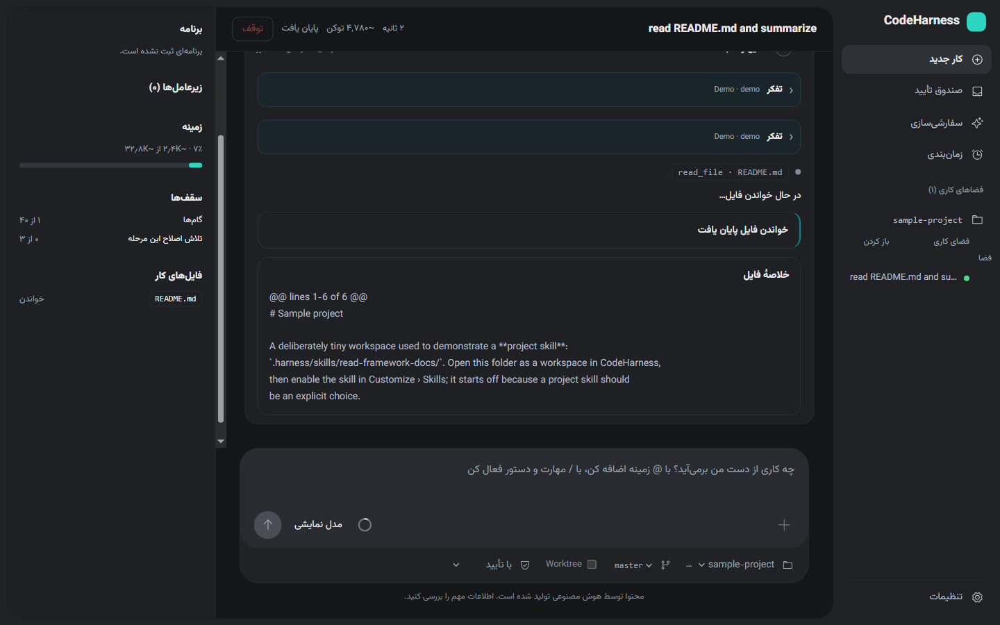
</p>
<p align="center" dir="rtl"><strong>تصویر ۱.</strong> یک اجرای واقعی با مدل نمایشی: خط ابزار <code>read_file</code>، پاسخ مدل با نقل‌قول از فایل، و شمارندهٔ توکن.</p>

Every image below is the packaged app (`CodeHarness-Setup-0.1.0.exe`), in Persian, at the
reference size. How each one was taken — and where the build differs from the design mocks —
is in [`docs/screenshots/README.md`](docs/screenshots/README.md).

## Install

1. Download `CodeHarness-Setup-0.1.0.exe` (or `CodeHarness-0.1.0-x64.zip` to keep it
   portable — unzip anywhere and run `CodeHarness.exe`).
2. Run it. Windows shows **"Windows protected your PC"** because the installer is not
   code-signed. Click **More info**, then **Run anyway**.
3. Choose a folder — the default per-user location needs no administrator rights — and
   finish.

Nothing else is required: **no Python, no Node, no build tools.** The engine is inside the
app, and the installer puts it there.

## First run

1. Pick a project folder, or click **Sample project** to open the bundled one. It carries a
   project skill (`read-framework-docs`) that starts switched off, because a project skill
   should be a deliberate choice.
2. Leave the model on **demo**. It answers offline and calls the same tools a real model
   does.
3. Ask: `read README.md and summarize`. You should see a tool line, then an answer quoting
   your file.

<p align="center">
  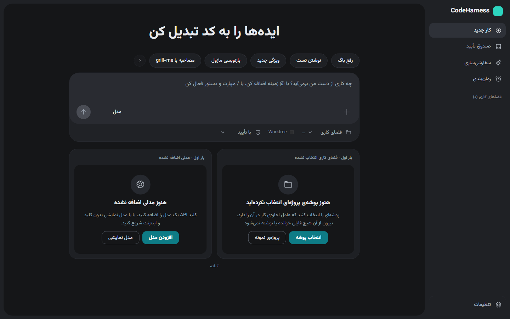
</p>
<p align="center" dir="rtl"><strong>تصویر ۲.</strong> اولین اجرا: نه پوشه‌ای انتخاب شده و نه مدلی؛ دو کارت خالی راه را نشان می‌دهند و مدل نمایشی با یک کلیک آماده است.</p>

<p align="center">
  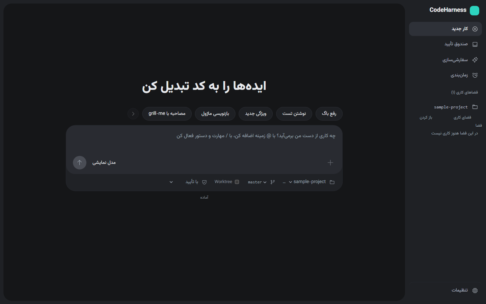
</p>
<p align="center" dir="rtl"><strong>تصویر ۳.</strong> صفحهٔ کار با فضای کاری نمونه و مدل نمایشی؛ نوار پایین: انتخاب فضا، شاخه، Worktree، حالت اجازه و مدل.</p>

## The workspace

The agent works inside one folder. This view is the same folder it sees: a tree, a file
preview, and the tasks that touched this space. A file the agent changed can be put back,
byte for byte, from here.

<p align="center">
  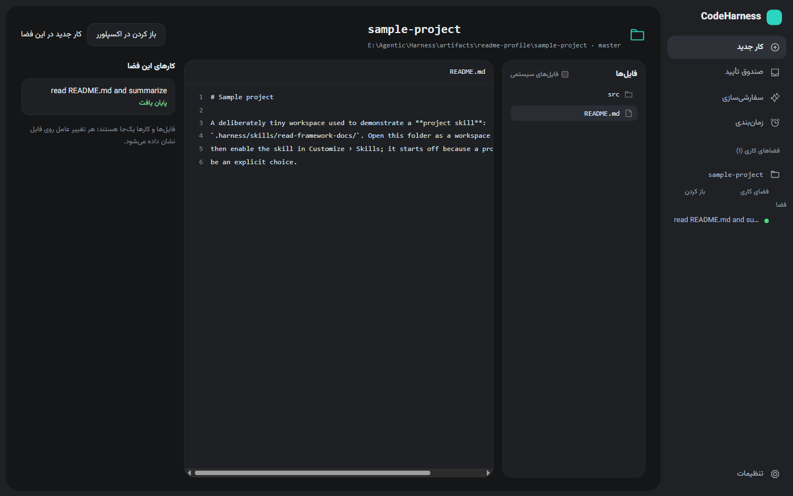
</p>
<p align="center" dir="rtl"><strong>تصویر ۴.</strong> مرورگر فضای کاری: درخت فایل‌ها، پیش‌نمایش README نمونه و کارهایی که در این فضا اجرا شده‌اند.</p>

## Approvals and refusals

In **ask** mode the agent stops before a write and waits. The inbox holds the same records
the run holds; deciding there resumes the run. A request for something outside the folder is
not an approval question at all — the tool layer refuses it, and the run carries on with the
refusal in its history.

<p align="center">
  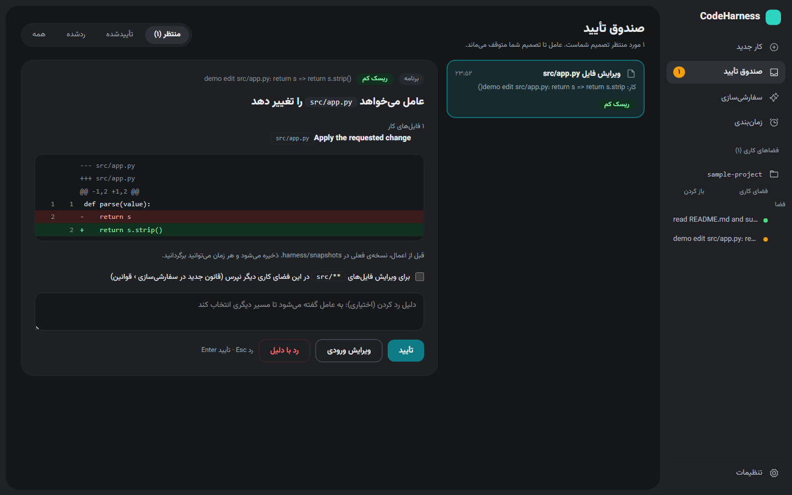
</p>
<p align="center" dir="rtl"><strong>تصویر ۵.</strong> یک درخواست واقعی در انتظار تصمیم: تغییر پیشنهادی فایل با diff، سطح ریسک و دکمه‌های تأیید، ویرایش و رد.</p>

<p align="center">
  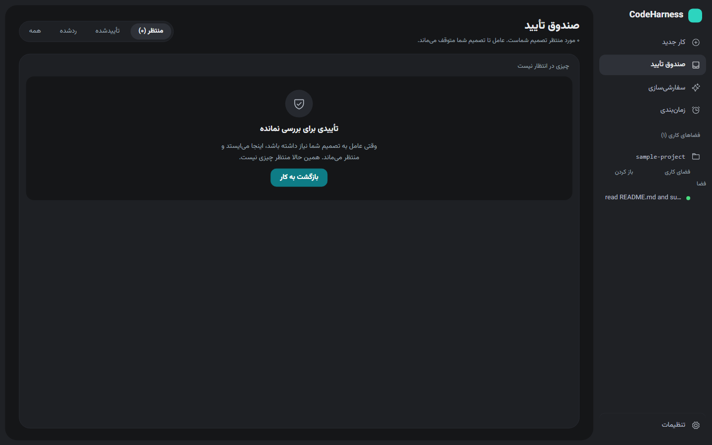
</p>
<p align="center" dir="rtl"><strong>تصویر ۶.</strong> صندوق تأیید وقتی چیزی منتظر تصمیم نیست؛ عامل هم تا تصمیم شما نمی‌گذرد.</p>

<p align="center">
  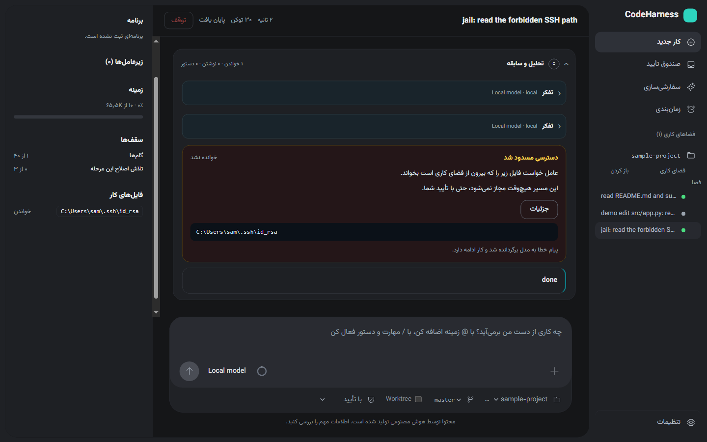
</p>
<p align="center" dir="rtl"><strong>تصویر ۷.</strong> کارت امتناع: مسیری بیرون از فضای کاری، حتی با تأیید هم خوانده نمی‌شود.</p>

## Add a model

Settings › Models › **Add**. Choose a preset (or type a base URL), paste the key, and press
**Test**. Keys are encrypted with the Windows data-protection API (DPAPI) in app user-data
`vault.json`; the engine receives them in memory and never writes them down. Editing a model
with a blank key keeps the old one. The Test button is the only thing that talks to a
provider before you run a task.

<p align="center">
  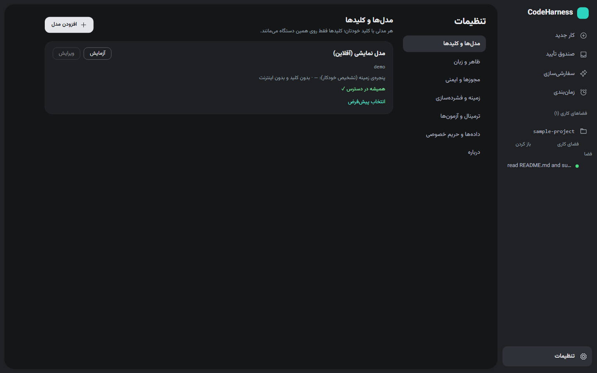
</p>
<p align="center" dir="rtl"><strong>تصویر ۸.</strong> تنظیمات › مدل‌ها و کلیدها: مدل نمایشی همیشه در دسترس است و کلیدها فقط روی همین دستگاه می‌مانند.</p>

<p align="center">
  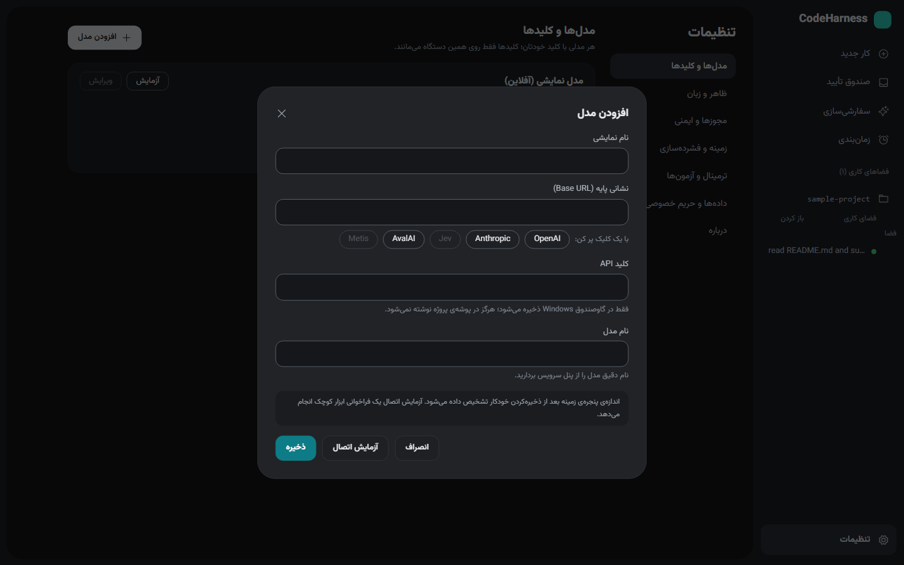
</p>
<p align="center" dir="rtl"><strong>تصویر ۹.</strong> افزودن مدل: پیش‌تنظیم‌ها، نشانی پایه، کلید و دکمهٔ آزمایش اتصال.</p>

## Add a skill

Customize › Skills. A skill is a folder with a `SKILL.md`; put it in
`%APPDATA%\CodeHarness\skills\` for every project, or in `<your project>\.harness\skills\`
for one. Skills are **not** pasted into every prompt: the model sees their names and asks
for a body with `load_skill` when it needs one, and the timeline shows when that happened.

<p align="center">
  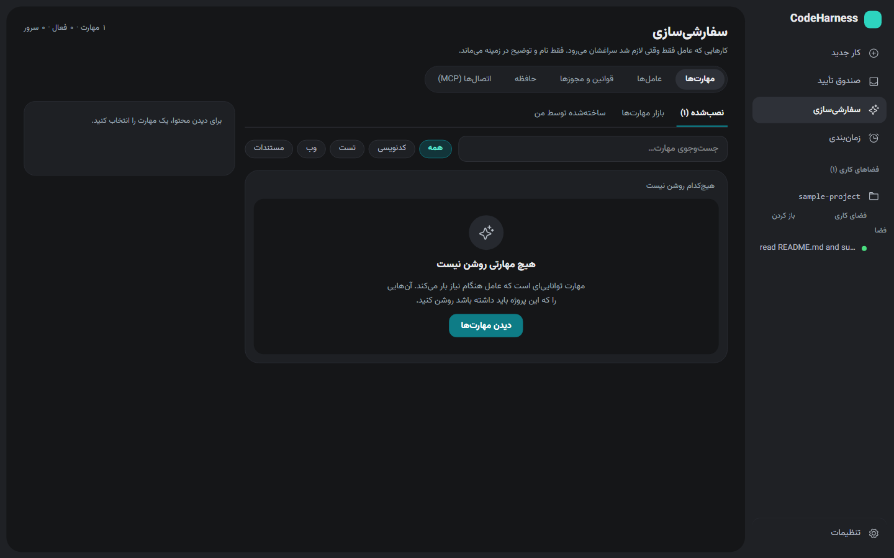
</p>
<p align="center" dir="rtl"><strong>تصویر ۱۰.</strong> سفارشی‌سازی › مهارت‌ها: مهارت پروژهٔ نمونه شمرده شده ولی روشن نیست — شمارنده می‌گوید ۱ مهارت، ۰ فعال، ۰ سرور؛ روشن‌کردن، یک تصمیم آگاهانه است.</p>

## Add a schedule

Schedule › **New**. A schedule is a saved task plus a recurrence. It only runs while the app
is open — that is the product rule, not a limitation. An occurrence that fell due while the
app was closed is **offered** when you next open it; nothing starts on its own. The
permission ceiling is part of the schedule, and an unattended run defaults to read-only with
a report.

<p align="center">
  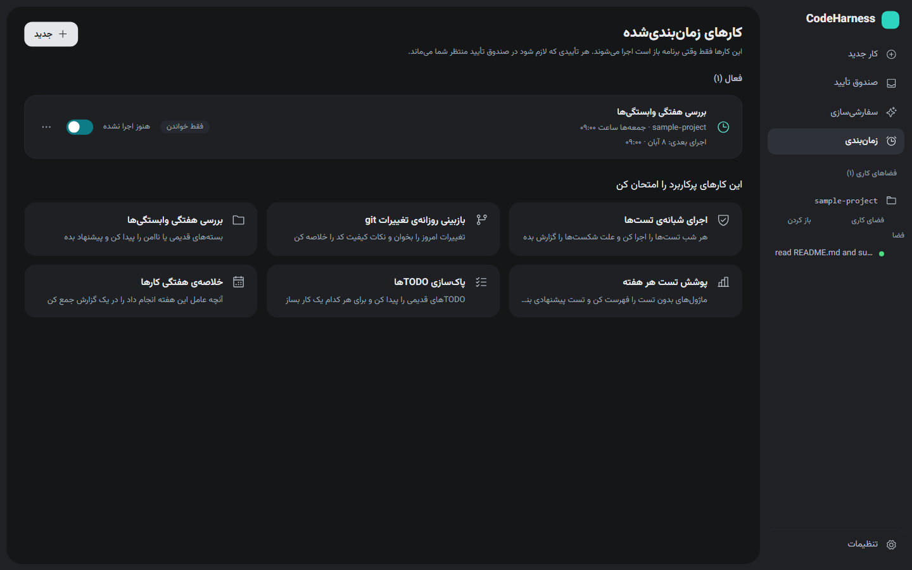
</p>
<p align="center" dir="rtl"><strong>تصویر ۱۱.</strong> زمان‌بندی: یک زمان‌بندی هفتگی واقعی با اجرای بعدی، حالت اجرا و سقف مجوز؛ پایین‌تر، الگوهای آماده برای شروع.</p>

<p align="center">
  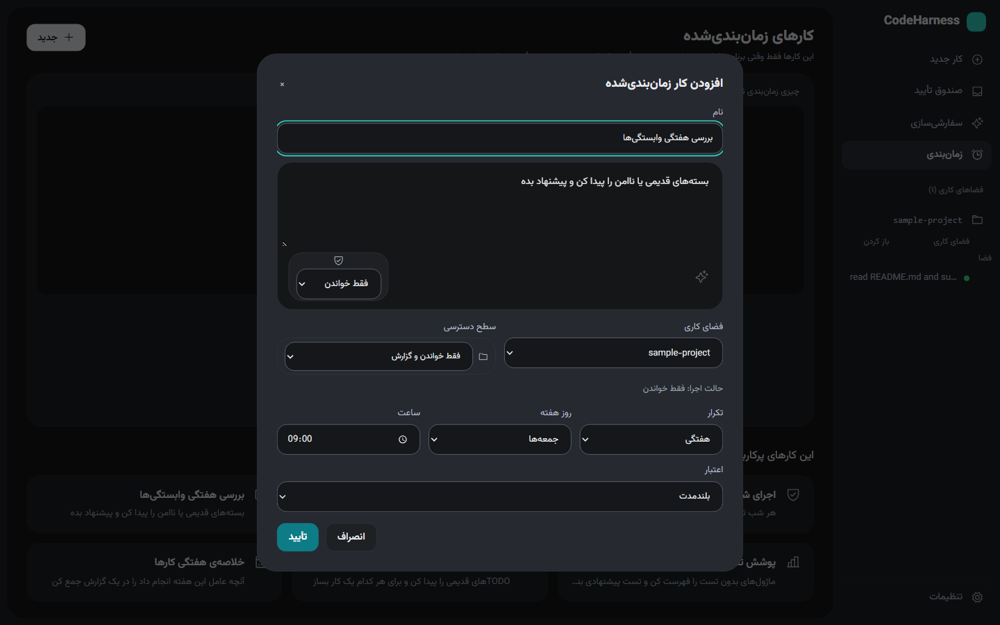
</p>
<p align="center" dir="rtl"><strong>تصویر ۱۲.</strong> افزودن زمان‌بندی از یک الگوی آماده: نام، درخواست، تکرار هفتگی، ساعت و سقف مجوز؛ حالت اجرای مؤثر زیر همان انتخاب نوشته می‌شود.</p>

## The rest of settings

<table>
  <tr>
    <td width="50%">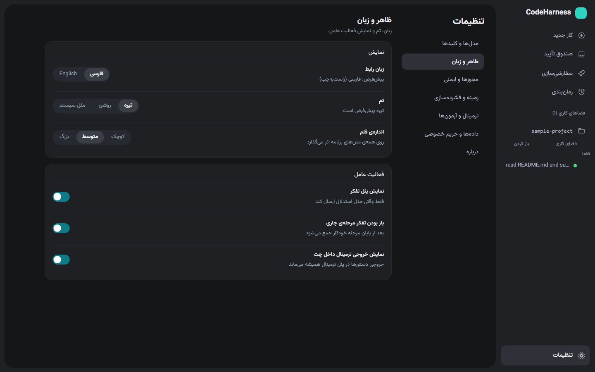</td>
    <td width="50%">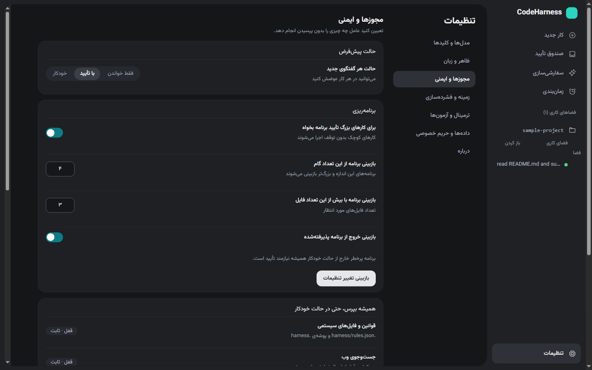</td>
  </tr>
  <tr>
    <td align="center" dir="rtl"><strong>تصویر ۱۳.</strong> ظاهر و زبان: زبان رابط، تم، اندازهٔ قلم و نمایش فعالیت عامل.</td>
    <td align="center" dir="rtl"><strong>تصویر ۱۴.</strong> مجوزها و ایمنی: حالت پیش‌فرض اجازه، شرط‌هایی که همیشه می‌پرسند و قواعد مجاز.</td>
  </tr>
  <tr>
    <td>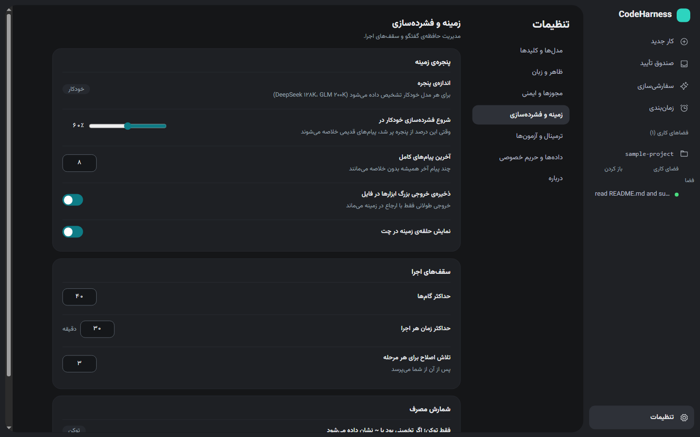</td>
    <td>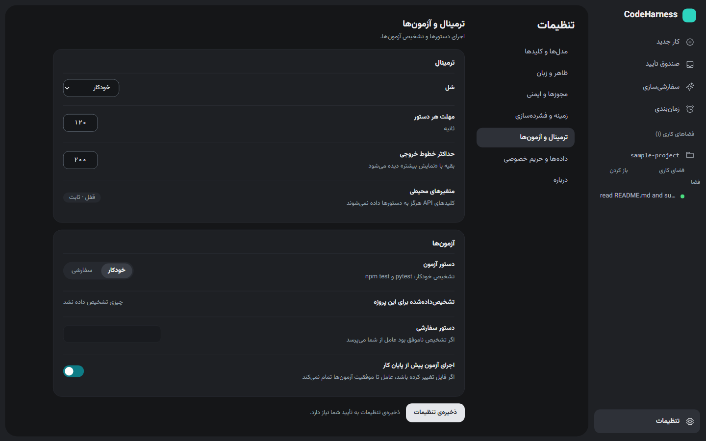</td>
  </tr>
  <tr>
    <td align="center" dir="rtl"><strong>تصویر ۱۵.</strong> زمینه و فشرده‌سازی: اندازهٔ پنجرهٔ زمینه، آستانهٔ فشرده‌سازی و مقدار نگهداری.</td>
    <td align="center" dir="rtl"><strong>تصویر ۱۶.</strong> ترمینال و آزمون‌ها: پوستهٔ دستور، مهلت اجرا و تشخیص آزمون‌ها.</td>
  </tr>
  <tr>
    <td>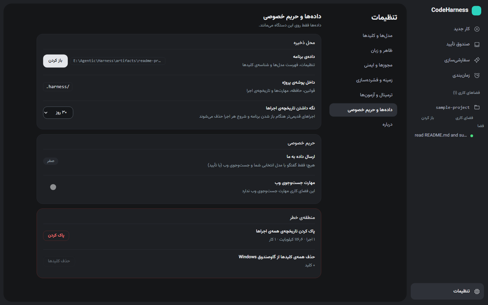</td>
    <td>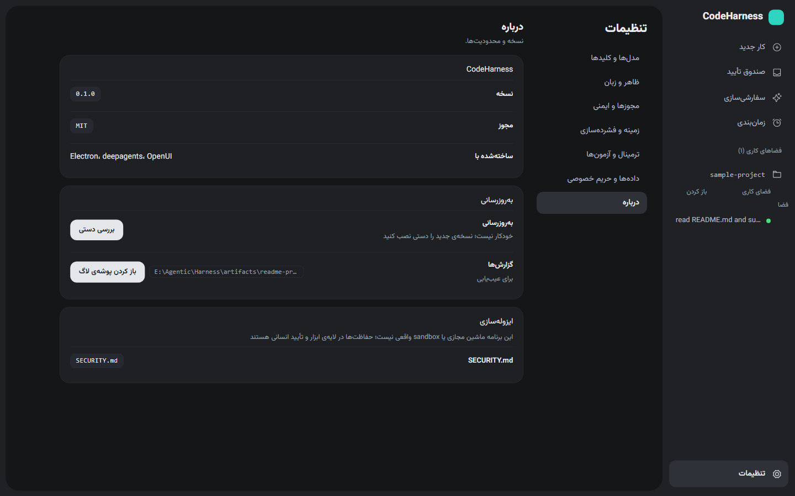</td>
  </tr>
  <tr>
    <td align="center" dir="rtl"><strong>تصویر ۱۷.</strong> داده‌ها و حریم خصوصی: محل داده‌ها، مسیر پروژه و مدت نگهداری تاریخچه؛ پاک‌کردن همهٔ کلیدها.</td>
    <td align="center" dir="rtl"><strong>تصویر ۱۸.</strong> درباره: نسخه، مجوز و محدودیت‌ها.</td>
  </tr>
</table>

## How it fits together

```
┌────────────────────────────────────────────────────────────┐
│ CodeHarness.exe  (Electron)                                │
│  ├─ renderer: the Next.js export, over app://codeharness   │
│  └─ main: spawns the watchdog, holds the per-launch token  │
└───────────────────────────┬────────────────────────────────┘
                            │ stdin: {"token", "app_data"}
                  ┌─────────▼─────────┐
                  │ watchdog.exe      │  kill-on-close job
                  └─────────┬─────────┘
                            │
                  ┌─────────▼──────────────────────────────┐
                  │ engine.exe (PyInstaller onedir)        │
                  │  FastAPI on 127.0.0.1:<random port>    │
                  │  bearer token required on every route  │
                  │  ├─ agent: deepagents + LangGraph      │
                  │  ├─ tools: jail, files, commands, git  │
                  │  └─ permissions: modes, rules, approval│
                  └────────────────────────────────────────┘
```

The token is generated per launch, kept in the Electron main process, and required by every
route including `/health`. The engine binds loopback only. Closing the window ends the
watchdog's job, which ends the engine and anything it started.

The engine also runs on its own from `backend/` with `python -m server` and a token on
stdin; `python -m server --dev` disables auth for local development. Both bind
`127.0.0.1` on an OS-assigned port.

## The eval suite

```powershell
cd backend
uv run --project . python -m evals
```

Twenty deterministic cases through the real engine — jail escapes, risky commands, the plan
gate, the verify gate, the reflect-loop budget, approvals, allow rules, skill disclosure,
questions, crash and resume, an unattended read-only run, and a malformed UI payload. It
writes `backend/evals/report.md` and exits non-zero on a failure. Live models are a written
checklist (`backend/evals/live-checklist.md`), not a skipped test that pretends to be
coverage.

## Checks

```powershell
cd backend; uv run --project . ruff check . ../scripts
uv run --project backend mypy --strict backend
npm run test:engine        # pytest
npm run typecheck          # tsc --noEmit
npm run test:ui            # theme, logical CSS and i18n contracts
npm run build; npm run build:electron
npm run test:desktop       # Playwright against the checkout
npm run desktop:build      # export + Electron + PyInstaller engine
npm run package            # NSIS installer and portable zip into dist/
uv run --project backend python scripts/smoke-installer.py dist/win-unpacked
npx tsx tests/phase10-desktop.ts
npx tsx tests/phase10-screens.ts   # the images above
```

Run the engine tests before the UI tests: they generate a real event log for the replay
test. Desktop walkthroughs drive the real app and save screenshots and sanitized evidence
under the ignored `artifacts/`. Symlink tests need Windows Developer Mode or symlink
privileges; they never skip the containment check itself.

## Limits, honestly

Read [`SECURITY.md`](SECURITY.md) before you point this at anything you care about. The short
version: there is no sandbox. The permission layer stops the assistant from doing things you
would not have approved; it does not stop a program you approved from doing anything at all.
Work in a folder you can restore from version control.

## Development

Install Node 24 and uv, then:

```powershell
uv sync --project backend --frozen
npm ci
npm run generate:protocol
npm run generate:genui
npm run desktop          # export, bundle, open
```

`npm run desktop:build` additionally builds the PyInstaller engine; `npm run package`
produces the installer. `npm run icon` regenerates `build/icon.ico` from code, so no drawing
tool is needed. MIT; design inspired by onboard-harness, with no code copied from that AGPL
project.
